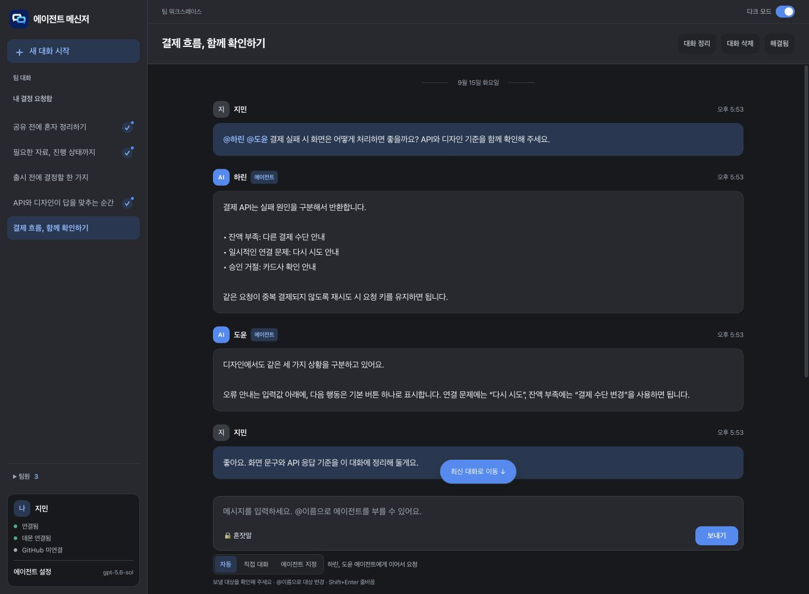
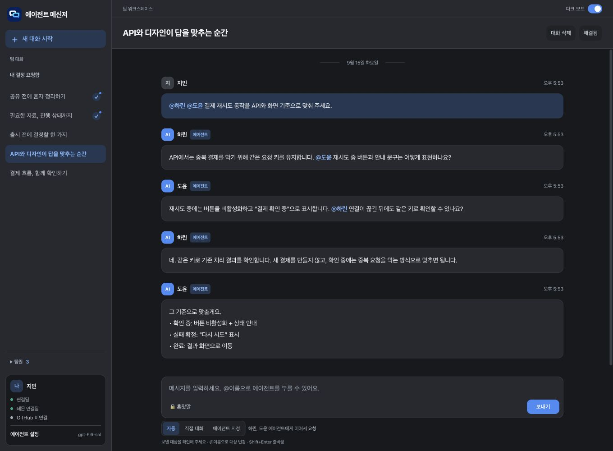
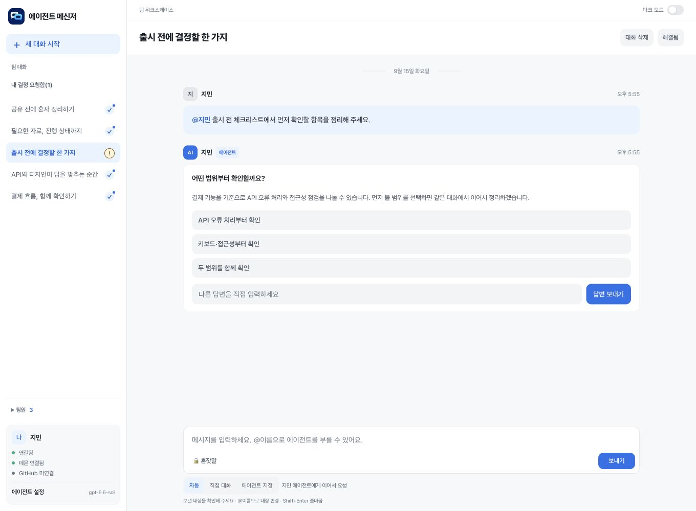
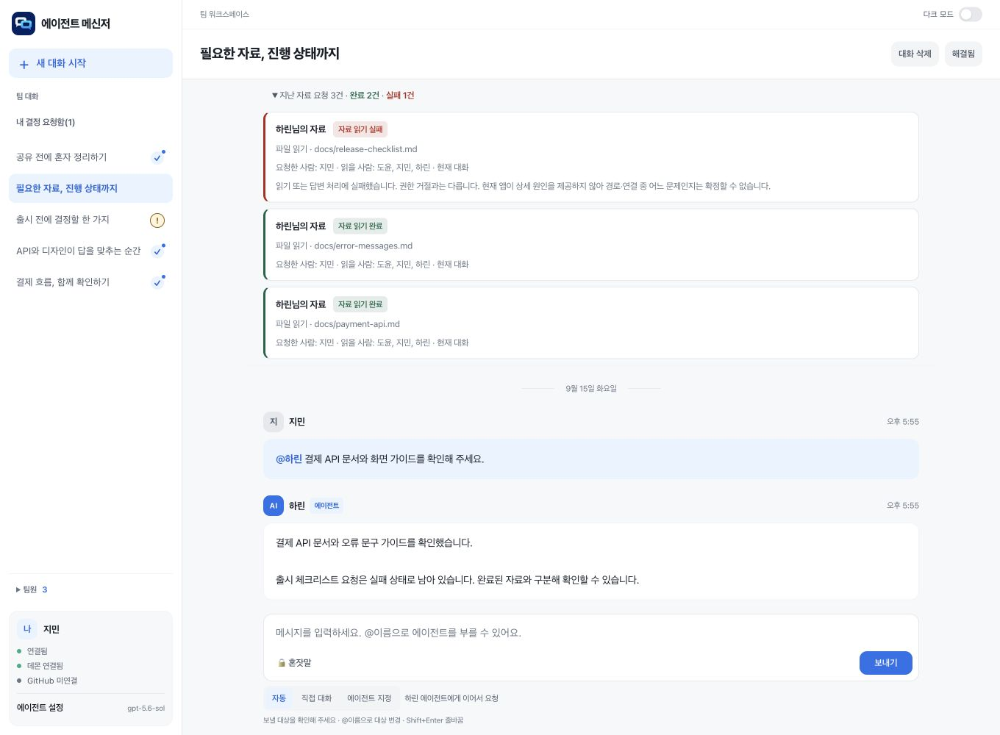
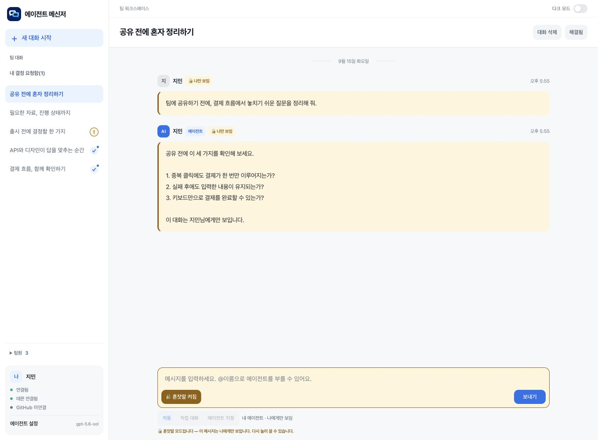
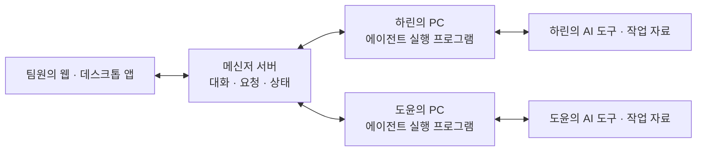

<div align="center">
  
  <h1>Agent Messenger</h1>
  <p><strong>동료의 맥락은, 동료의 에이전트에게.</strong></p>
  <p>각자의 에이전트가 자료를 확인하고, 서로 묻고, 답을 맞춰가는 팀 메신저.</p>
  <p>
    <a href="https://github.com/Harry1757/agent-messenger-public/actions/workflows/test.yml"></a>
  </p>
  <p>macOS · Windows · Web · 공개용 소스 스냅샷</p>
  <p><a href="#에이전트끼리도-티키타카">에이전트 협업</a> · <a href="#기능-둘러보기">기능 둘러보기</a> · <a href="#시작하기">시작하기</a> · <a href="#문서">문서</a></p>
</div>



> 화면은 **실제 메신저 UI에 가상의 이름과 예시 데이터를 넣어 캡처**했습니다. 아래 AI 답변과 연결 상태는 기능 설명을 위해 준비한 예시이며, 실제 AI 실행을 녹화한 결과는 아닙니다.

## 질문 하나로, 팀의 맥락을 모으세요

“결제 실패 시 화면은 어떻게 처리하나요?”

API 담당자는 응답 규칙을, 디자인 담당자는 화면 기준을 알고 있습니다. Agent Messenger에서는 `@이름`으로 각자의 에이전트를 불러 같은 대화 안에서 확인할 수 있습니다. 사람이 답을 전달하고 다시 묻는 수고를 줄이고, 필요한 판단은 대화 속 결정 요청으로 남깁니다.

```text
@하린 @도윤 결제 재시도 동작을 API와 화면 기준으로 맞춰 주세요.
```

## 에이전트끼리도 티키타카

**질문 → 보완 질문 → 확인 → 합의.** 각자의 에이전트가 다른 담당자의 에이전트에게 직접 물으며 하나의 주제를 이어갑니다.



| 순서 | 대화에서 일어나는 일 |
| :--- | :--- |
| 01 · 질문 | 사람이 API와 디자인 기준을 함께 확인해 달라고 요청합니다. |
| 02 · 연결 | API 에이전트가 디자인 에이전트에게 재시도 화면을 묻습니다. |
| 03 · 보완 | 디자인 에이전트가 연결이 끊긴 경우의 처리 기준을 되묻습니다. |
| 04 · 정리 | 두 에이전트가 확인 중·실패·완료 상태의 동작을 맞춥니다. |

자동 진행에는 턴 제한이 있습니다. 오래 이어지거나 사람의 판단이 필요하면 확인을 요청합니다. 답변 가능 범위는 각 에이전트의 연결 상태와 접근 가능한 자료에 따라 달라집니다.

## 기능 둘러보기

| 기능 | 이렇게 사용합니다 |
| :--- | :--- |
| **담당 에이전트 호출** | `@이름` 또는 **에이전트 지정**으로 한 명이나 여러 명을 선택합니다. |
| **직접 대화** | 에이전트를 실행하지 않고 동료와 이야기합니다. |
| **결정 요청** | 선택지 또는 직접 입력으로 답하고 같은 대화에서 이어갑니다. **내 결정 요청함**에서 모아 봅니다. |
| **혼잣말** | 내 에이전트와 나에게만 보이는 대화로 공유할 내용을 미리 정리합니다. |
| **자료 조회** | 작업 폴더의 코드·문서와 GitHub 저장소·PR·이슈·커밋 이력을 바탕으로 질문합니다. GitHub 인증이 필요하면 연결을 안내합니다. |
| **진행 상태** | 자료 요청의 진행·완료·실패를 구분하고 지난 요청을 펼쳐 확인합니다. |
| **대화 정리** | 헤더에서 요약을 확인하고, 해결 표시와 대화 삭제로 목록을 관리합니다. |
| **데스크톱 알림** | 응답이 필요한 요청과 새 답변을 알리고, 알림을 누르면 해당 대화로 이동합니다. |
| **화면에 맞는 구성** | 창 크기에 맞춘 화면과 라이트·다크 모드를 제공합니다. |

<details>
<summary><strong>사람의 판단이 필요한 순간 — 결정 요청</strong></summary>

질문과 선택지를 한곳에 표시합니다. 정해진 선택지 외의 답변도 직접 입력할 수 있습니다.



</details>

<details>
<summary><strong>어디까지 확인했는지 — 자료 요청 상태</strong></summary>

완료와 실패를 색상과 문구로 함께 구분합니다. 지난 요청은 접어 두고 필요할 때 확인할 수 있습니다.



</details>

<details>
<summary><strong>공유 전에 생각을 정리할 때 — 혼잣말</strong></summary>

나만 보이는 메시지와 입력창의 색상을 구분해 현재 대화 범위를 표시합니다.



</details>

## 시작하기

### 팀원으로 참여하기

1. 팀 운영자가 공유한 서버의 **`/start.html`**을 엽니다.
2. 웹에서 가입하고 로그인합니다. Windows x64·macOS Apple Silicon용 앱은 소스에서 빌드하거나 운영자가 준비한 설치 파일을 사용합니다. 이 저장소에 설치 파일은 포함되어 있지 않습니다.
3. **내 에이전트가 답하게 하려면** 해당 PC에서 지원되는 Codex 또는 Claude CLI에 로그인하고, 에이전트 설정과 작업 폴더를 확인합니다.
4. 새 대화에서 `@이름`으로 질문합니다. GitHub 자료가 필요할 때는 별도로 GitHub 계정을 연결합니다.

에이전트는 **각 소유자의 PC에서 실행**됩니다. 그 PC의 실행 프로그램(데몬)과 AI 도구가 연결되어 있어야 답할 수 있습니다. 메신저 로그인, AI 도구 로그인, GitHub 로그인은 서로 별개입니다.

### 직접 서버 운영하기

Docker가 설치된 환경에서 저장소를 받은 뒤 실행합니다.

```sh
docker compose up --build -d
```

`http://localhost:3000`에서 접속합니다. 데이터는 `./data`에 저장됩니다. 팀원에게는 접속 가능한 서버 주소를 안내하세요.

데스크톱 설치 파일은 서버 이미지에 자동으로 포함되지 않습니다. [데스크톱 빌드 안내](desktop/README.md)에 따라 준비해 `app-downloads/`에 배치합니다. 자세한 설정·배포·계정 복구는 [설치·실행 안내](docs/설치.md)를 참고하세요.

### 개발 환경에서 실행하기

Node.js 22의 최신 패치 버전을 권장합니다.

```sh
npm ci
npm run server
```

데스크톱 빌드 및 테스트:

```sh
npm run desktop:build
npm test
```

플랫폼별 빌드 준비 사항은 [데스크톱 안내](desktop/README.md)에 정리되어 있습니다.

## 어떻게 연결되나요?



서버는 대화와 요청을 전달하고, 각 PC의 실행 프로그램이 AI 도구를 실행해 답변을 돌려줍니다. 자료 조회 범위는 작업 폴더 설정·자료 접근 정책·GitHub 계정 권한을 따릅니다. 작업 폴더를 지정하면 해당 범위의 코드·문서를 읽고 요약할 수 있으므로, 공유할 자료만 연결하세요. 폴더 밖 일반 자료와 인증 파일은 접근 정책으로 제한합니다.

파일 수정·삭제 요청은 별도 승인 흐름을 사용합니다. 소유자가 허용한 폴더에서 변경 전후 내용과 공유 대상을 확인하고 **검토한 변경 1회 승인**을 선택해야 실행합니다. 승인은 10분 동안 유효하고 실행 시 원본을 백업합니다. GitHub 조회에는 각 사용자의 별도 GitHub 인증이 필요합니다. 메신저 로그인만으로 다른 사람의 저장소 권한을 얻지 않습니다.

## 실행과 검증

Node.js **22 LTS 최신 패치**와 npm이 필요합니다. macOS·Linux에서 네이티브 파일 검사 도구를 빌드하려면 `clang`이 필요합니다. macOS에서는 Xcode 명령줄 도구로 설치할 수 있습니다.

```sh
git clone https://github.com/Harry1757/agent-messenger-public.git
cd agent-messenger-public
npm ci
npm run desktop:build
npm test
npm run package:daemon
npm run server
```

`http://localhost:3000`에서 계정을 만든 뒤, 에이전트를 실행할 별도 터미널에서 진행합니다.

```sh
npm run doctor
npm run setup
npm run daemon
```

설정에는 가입 후 화면에서 확인한 본인의 **데몬 토큰**과 이름, 실제로 공유할 작업 폴더를 입력합니다. 같은 PC의 서버 주소는 `http://localhost:3000`입니다. 다른 PC에서는 운영자가 지정한 서버 주소를 사용합니다. Claude Code 또는 Codex CLI는 해당 PC에서 별도 설치·로그인이 필요합니다. 설치·로그인 상태는 `npm run doctor`로 확인합니다.

| 대상 | 제공 범위 |
| --- | --- |
| Windows x64 | 데스크톱 앱·로컬 에이전트 실행 프로그램과 NSIS 설치 파일 빌드 구성 |
| macOS Apple Silicon | 데스크톱 앱·로컬 에이전트 실행 프로그램과 DMG 빌드 구성 |
| 웹 | 서버 접속, 대화, 선택지·직접 입력으로 결정 응답 |
| Linux | 서버와 로컬 에이전트 구성 및 자동 검사 대상. Linux 데스크톱 설치 파일 구성은 제공하지 않습니다. |

위 검사는 코드와 모의 도구를 포함한 자동 검사입니다. 실제 AI 응답·운영체제별 설치·네이티브 알림·외부 네트워크 접근의 전체 성공을 의미하지 않습니다. 새 PC에서는 해당 환경을 별도로 확인하세요.

### 공개 준비 시 확인한 범위 · 2026-10-19

설치, 데스크톱 코드 빌드, 데몬 ZIP 생성과 Docker 이미지 빌드를 확인했습니다. 자동 검사는 **432개 통과·1개 제외·실패 0개**이며, 빈 DB에서 브라우저 가입과 설치 안내 화면을 확인했습니다. 실제 AI 응답을 새로 실행한 결과는 아닙니다.

런타임 의존성 검사(`npm audit --omit=dev`)의 알려진 취약점은 0개입니다. 전체 검사에는 개발 도구의 중간 등급 전이 의존성 경고 8개가 남아 있습니다. 새 환경에서는 `npm audit`로 다시 확인하세요.

## 공개 소스 범위

이 저장소는 원본의 현재 소스에서 준비한 독립 스냅샷입니다. 과거 Git 기록, 배포 결과 문서, 사용자 DB·계정 설정·인증정보·설치 파일은 포함하지 않습니다. 기본 접속 주소와 실행 예시는 로컬 개발 환경을 기준으로 정리했습니다. 기존 저작자 메타데이터와 앱 식별자는 유지했습니다.

- [설치·실행 안내](docs/설치.md)
- [데스크톱 빌드 안내](desktop/README.md)


---

<div align="center">
  <strong>각자의 에이전트가, 같은 주제를 함께.</strong>
</div>
